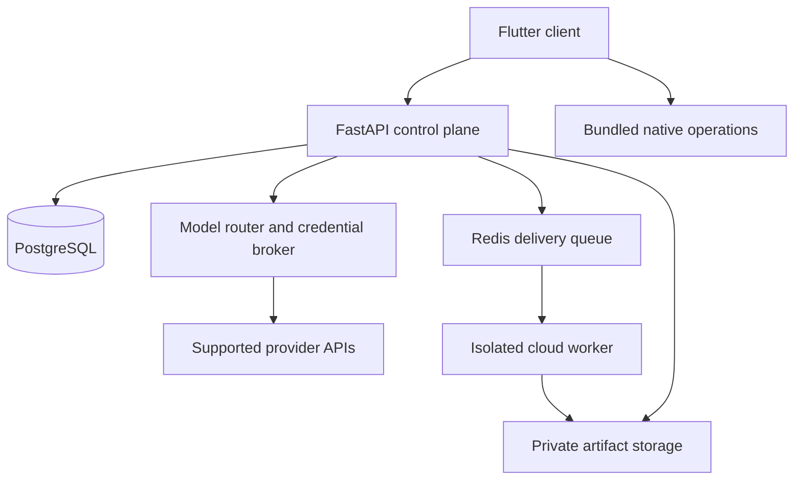

# Creator S7 architecture v0.1
Status: implementation baseline draft, not an approved production specification.

## Product and first milestone
Android-first, Flutter/Dart client with later iOS support. Users choose a skill and
provider, approve a script/storyboard, submit a render, return after closing the app,
preview the result and save an MP4. The first vertical slice uses Faceless Shorts
Inside Out, English AI narration, one approved storyboard and cloud execution.
All six source styles ship in the development package; availability badges remain
experimental until each passes rendering and visual review.

## Responsibilities
| Boundary | Owns | Must not own |
|---|---|---|
| Flutter client | input, approvals, local project cache, preview/export | unrestricted downloaded code |
| Model router | capabilities, provider choice, quotas, cost ceiling | container placement |
| Workflow orchestrator | typed DAG, approvals, retries, checkpoints | shell access or secret values |
| Runtime scheduler | placement, leases, resource reservations | deciding what user approved |
| Worker | allowlisted operations, rendering, validation | user/session database credentials |
| Project service | ownership, immutable revisions, artifact lineage | provider-specific response formats |

Use a modular FastAPI monolith initially, PostgreSQL for durable metadata and job
truth, Redis as delivery/cache infrastructure, S3-compatible private artifact storage.
Separate isolated render-worker processes from the API from the first runnable slice.
Do not split every module into independently deployed microservices in the MVP.

## Hybrid execution
Local MVP operations: project editing, picking files, media playback, download,
and export through platform APIs. Their inputs and permissions are explicit.
Cloud MVP operations: Kokoro, Whisper alignment, Chrome capture, FFmpeg and generated
animation code. The planner emits a typed plan; a policy service admits it; a worker
maps operation IDs to vetted entrypoints. Never turn Markdown into a shell command.
Local arbitrary Python/JS execution is a feasibility track, not a shipped capability.

iOS downloaded-code restrictions require a distinct product/store review decision.
Android WorkManager is for durable scheduling and status/download work; it is not an
unlimited render daemon. Android 16 imposes quota constraints on long-running work.
These decisions are derived from the official sources below, not a guarantee of
app-store acceptance. Cloud jobs continue independently when the phone sleeps.

## Data and secrets
Tenant/user identity is derived from authenticated server context. Every project,
job, skill installation and artifact read is ownership checked, including signed-URL
issuance. Unpredictable IDs alone are not authorization. Optional organization IDs
are deferred until membership rules exist.

BYOK has two explicit modes: device-only keys in Keychain/Keystore for supported
direct API operations; or cloud-enabled encrypted credentials stored behind a
credential broker after disclosure/consent. Workers receive short-lived scoped
credentials or brokered responses, never the owner's master credentials. Ordinary
subscription logins do not automatically provide API entitlements. OAuth adapters
remain unavailable until the provider officially supports the required access.

Raw provider payloads, keys and presigned URL query strings must be excluded from
logs. Store usage counts and sanitized request IDs. Deleting a credential blocks new
leases immediately, cancels queued dependent steps and revokes active leases where
possible; an already delivered provider request may still complete.

## Durable workflow
The API transaction writes job changes and an outbox entry atomically. A dispatcher
delivers the outbox to Redis. Workers obtain a PostgreSQL lease with a monotonic
fencing token; duplicate delivery cannot commit duplicate results. Queue loss can
be repaired from durable rows. Each output is content-addressed and committed only
after ownership, checksum and media checks. Notifications are hints, never job truth.

## Storage and database
Use UUID IDs, UTC timestamps, tenant checks and migrations. Proposed core relations:
users; provider_connections (mode, credential_ref, consent_revision);
skills; skill_versions (version, manifest_digest, trust_status);
installed_skills (user_id, version_id); projects; project_revisions;
assets (owner, digest, media_type, bytes, storage_ref, retention_state);
workflows; workflow_steps; jobs (state, revision, lease, attempt, error);
approvals (plan_digest, scopes, ceiling, expiry, consumed_at);
job_events (job_id, seq unique); outbox; usage_reservations; usage_ledger.
Unique (user_id, idempotency_key) for submissions; (job_id, step_id, input_digest)
for step commits. Retain provenance through every derived artifact.
Schema migrations, SQL DDL and row-level policies are implementation deliverables,
not included SQL that has already been applied.

## Threat and execution boundary
Untrusted skills, model output, HTML and archives are inputs. Verify package paths,
hashes and trust before planning; execute only pinned trusted worker images.
Containers run non-root, read-only rootfs, capped tmpfs, no host mounts/docker socket,
dropped capabilities and deny-by-default egress. A container alone is not a sufficient
boundary for arbitrary hostile native code: third-party code execution remains off
until stronger sandbox isolation and escape tests pass.
Block loopback/private network access except explicitly required worker-local capture
services. Browser capture has a separate constrained network namespace. A provider
broker holds external API access outside the renderer. No package-time dependency
install hooks execute on the phone or API host.

## Retention and operations
Proposed development defaults: temporary artifacts 24 hours, final cloud artifacts
7 days unless retained, redacted operational logs 14 days. Display policy before upload;
final production periods require product approval. Delete operations enqueue storage
cleanup, track tombstones and disclose backup expiry separately. Project metadata
is not marked fully erased while known live objects remain.
Observe queue wait, step latency, retries, cost reservations, render duration,
memory high-water mark, output size and validation failures. Never label progress
as a percentage unless total work is known; expose phase and heartbeat age.

## Evidence and open decisions
- Existing Faceless Shorts source inspection: Node 22+, desktop Chrome, FFmpeg,
  Kokoro (~340 MB) and Whisper small.en (~0.5 GB); downloaded weights are not included.
- [Apple App Review 2.5.2](https://developer.apple.com/app-store/review/guidelines/)
- [Android long-running WorkManager guidance](https://developer.android.com/develop/background-work/background-tasks/persistent/how-to/long-running)
Open before release: Flutter/Python dependency version locks, hosting region, signing
key custody, model/font licensing, minimum Android device, Hindi TTS/alignment,
cloud budget and benchmark hardware. No delivery timeline is asserted yet.
